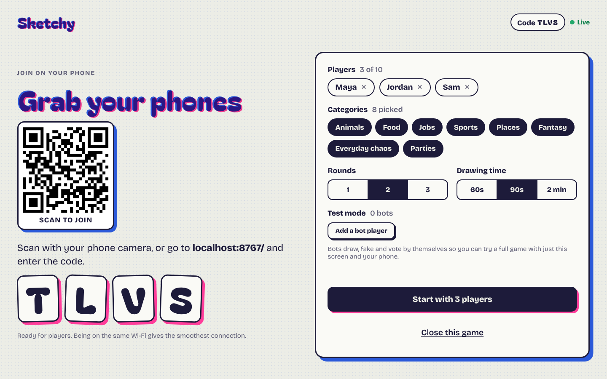
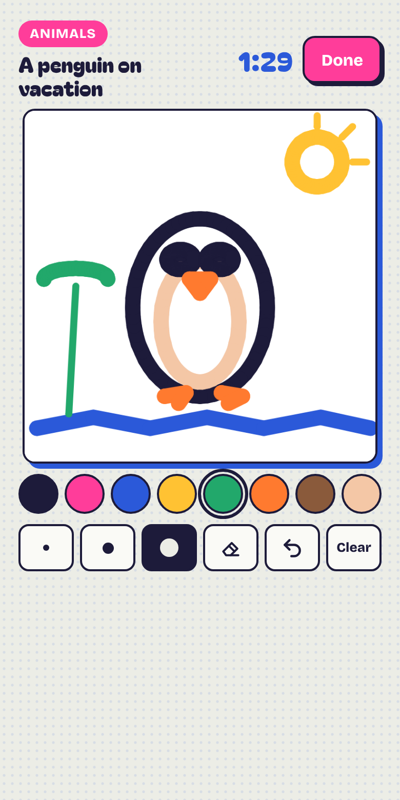
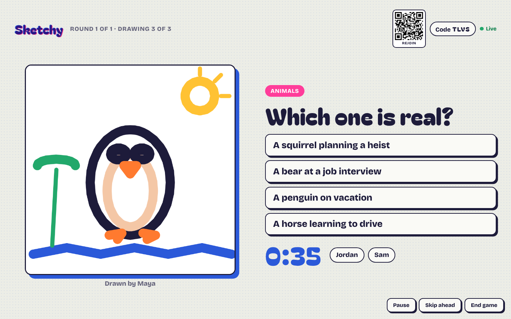
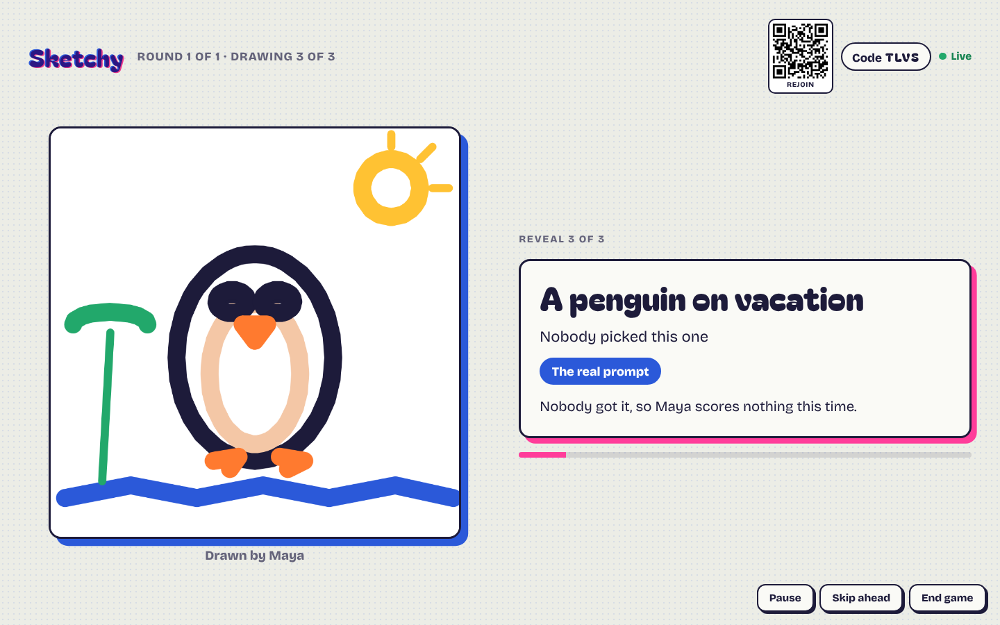

# Sketchy

**A free, open-source drawing party game for 2 to 10 players.** Put the game on a TV or laptop, everyone joins from their phone's browser, and you take turns drawing secret prompts, inventing fake titles and voting for the real one.

No accounts, no app to install, no server to run. It's one static web page.

<!-- After you turn on GitHub Pages, replace the link below with your own. -->
**▶ Play:** `https://YOUR-USERNAME.github.io/sketchy/`



| Draw on your phone | Vote on the big screen | The reveal |
|---|---|---|
|  |  |  |

---

## How to play

1. **Open the game on a big screen** (TV, laptop, projector) and choose **Host on the big screen**.
2. **Everyone joins on their phone.** Scan the QR code, or open the same link and type the 4-letter code.
3. **Pick categories** (Animals, Food, Fantasy, Everyday chaos…), rounds and drawing time, then press **Start**.
4. **Draw.** Each phone gets a secret prompt like *"a dragon at the dentist."* No letters or words allowed.
5. **Fake it.** Each drawing is replayed on the big screen. Everyone except the artist writes a fake title that sounds believable.
6. **Vote.** The real title and all the fakes appear on the big screen and on the phones. Pick the one you think is real.
7. **Reveal.** See who fooled whom, then on to the next drawing.

### Scoring

| What happened | Points |
|---|---|
| You picked the real title | **+2** |
| You drew it, per person who picked the real title | **+1** |
| Someone picked your fake title, per person fooled | **+1** |
| A "house fake" (added by the game when there are few players) fooled someone | nobody scores |

### Test mode

In the lobby, **Add a bot player** adds up to four bots that draw, fake and vote by themselves. You can try a whole game with just a laptop and your phone.

---

## Host your own copy

You can run your own copy for free in about five minutes:

1. **Fork** this repository (or create a new one and upload the files).
2. Go to **Settings → Pages → Build and deployment** and set **Source** to **GitHub Actions**.
3. Push to `main`, or run the **Deploy to GitHub Pages** workflow from the **Actions** tab.
4. Your game is live at `https://<your-username>.github.io/<repo-name>/`.

It also works on any static host (Netlify, Cloudflare Pages, Vercel, your own server). Upload `index.html`, `styles.css`, `favicon.svg` and the `js/` folder.

## Run it locally

```bash
git clone https://github.com/YOUR-USERNAME/sketchy.git
cd sketchy
npm start          # serves the folder on http://localhost:8080
npm test           # runs the codec and prompt-deck tests (Node 18+)
```

Any static file server works, for example `python3 -m http.server 8080`. To test on your own computer, open the game in one tab as the host and in other tabs as players. Each tab counts as a separate player.

To join from a real phone on your network, use your computer's local IP address (for example `http://192.168.1.20:8080`).

---

## How it works

```
 Phone ──┐                         ┌── Phone
 Phone ──┼──  WebRTC data channels ┼── Phone
         └──────►  Big screen  ◄───┘
                (runs the game)
```

- The **big screen is the game.** It holds all the state, deals prompts, keeps score and sends a small state update to every phone.
- **Phones are controllers.** They send their name, drawing, fake title and vote.
- Devices connect **directly** to each other over WebRTC using [PeerJS](https://peerjs.com/). PeerJS's free public broker only introduces the devices to each other. Game data doesn't pass through it.
- **Drawings are sent as strokes, not images.** That keeps them small and sharp on a TV, and lets the big screen replay them stroke by stroke.

See **[docs/ARCHITECTURE.md](docs/ARCHITECTURE.md)** for the message protocol, the phase state machine and the drawing format.

### Good to know

- Keep the big-screen tab open and in front for the whole game. If it closes, the game ends.
- Being on the **same Wi-Fi** is the most reliable setup. Some cellular and corporate networks block direct connections.
- If a phone locks or reloads, it rejoins automatically as the same player. The small QR code in the corner of the big screen works too.

## Privacy

Sketchy has no accounts, analytics or database. Names, drawings and guesses exist only in the browsers of the people playing and are gone when the big-screen tab closes. The PeerJS broker sees connection metadata (random peer IDs and IP addresses) needed to set up the connections.

---

## Contributing

Contributions are very welcome, especially from people who've never contributed to open source before. The easiest first contribution is **adding prompts**, and you can do it entirely in the GitHub website editor.

- 🖍️ **New prompts or categories:** edit [`js/prompts.js`](js/prompts.js)
- 🐛 **Bugs and ideas:** [open an issue](../../issues/new/choose)
- 🛠️ **Code:** read **[CONTRIBUTING.md](CONTRIBUTING.md)** first

Please follow the [Code of Conduct](CODE_OF_CONDUCT.md).

## Project layout

```
index.html          the page shell
styles.css          all styles (big screen + phone)
favicon.svg
js/prompts.js       the prompt deck  ← easiest place to contribute
js/codec.js         drawing encode/decode, simplification, rendering
js/game.js          home screen, host (big screen) and player (phone) logic
tests/              node:test tests for the codec and the prompt deck
docs/               architecture notes and screenshots
.github/            CI, GitHub Pages deploy, issue and PR templates
```

There's no build step and no framework. Edit a file, reload the page.

## License

[MIT](LICENSE). Use it, change it, share it with your friends.
