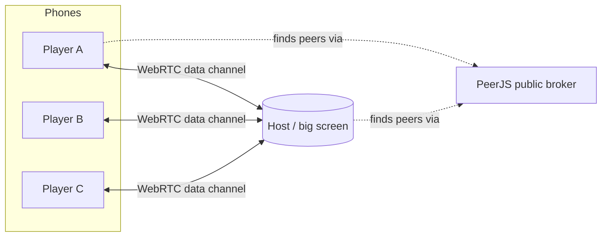
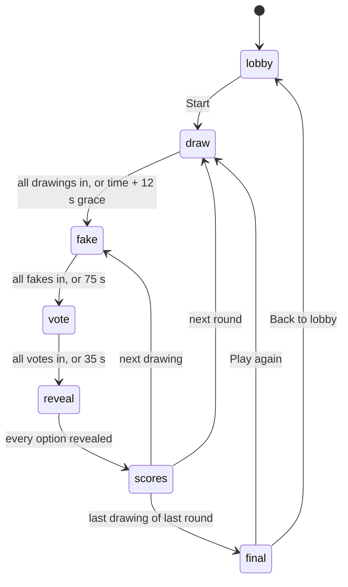
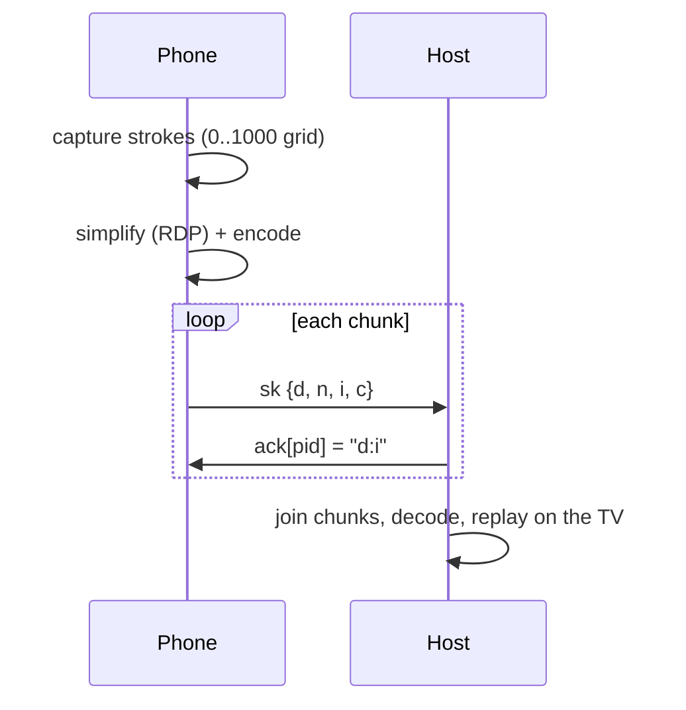

# Sketchy architecture

This document explains how Sketchy works under the hood. Read it before you change game flow, networking or the drawing format.

## Overview

Sketchy is a static web page with three roles, all in `js/game.js`:

| Role | Where it runs | Responsibility |
|---|---|---|
| **Home** | Any device | Choose *Host on the big screen* or *Join on this phone* |
| **Host** | TV or laptop | Owns all game state: players, prompts, drawings, fakes, votes, scores, timers |
| **Player** | Each phone | Draws, writes a fake title, votes. Shows whatever the host says is happening. |



There's no game server. The host browser *is* the server.

## Connections

Sketchy uses [PeerJS](https://peerjs.com/) (loaded from unpkg) over WebRTC data channels.

- The host registers the peer ID `sketchy-party-v1-<code>`, where `<code>` is the 4-letter game code in lowercase (consonants only, so it never spells a word). If the ID is taken, the host picks a new code.
- A player creates an anonymous peer and connects to `sketchy-party-v1-<code>`.
- If a connection drops, the player retries every 2.5 seconds. The host keeps the player's seat, keyed by player ID.
- `window.SKETCHY_PEER` can override the PeerJS options (for example, to point at your own [PeerJS server](https://github.com/peers/peerjs-server) in tests).

Changing the protocol? Bump `v1` in `hostIdFor()` so mismatched versions never connect.

## Messages

Both sides send **absolute state** (the whole object) rather than events. A reconnecting device needs only the latest message to catch up.

### Host → phones: `{ t: "h", pres: HostState }`

Broadcast to every phone whenever the state changes, and sent to each new connection when it opens.

| Field | Type | Meaning |
|---|---|---|
| `role` | `"host"` | |
| `code` | string | Game code |
| `ph` | string | Phase: `lobby`, `draw`, `fake`, `vote`, `reveal`, `scores`, `final` |
| `rd`, `rds` | number | Current round and total rounds |
| `t` | number | Host clock (ms) when sent. Phones use it to estimate clock skew. |
| `end` | number | Host-clock deadline for the current input phase (0 = none) |
| `pz` | 0 or 1 | Paused |
| `in` | string[] | Player IDs in the game |
| `sc` | `{pid: score}` | Scores |
| `pr` | `{pid: [category, prompt, drawingId]}` | **Draw phase only.** Each player's secret prompt. |
| `ack` | `{pid: "drawingId:chunkIndex"}` | **Draw phase only.** Last drawing chunk the host received from each player. |
| `did`, `art`, `cat` | string | Current drawing ID, artist's player ID, category |
| `opts` | string[] | **Vote phase only.** Options in display order (the truth isn't marked) |
| `done` | string[] | Player IDs who finished the current step |
| `rej` | `{pid: {x, r}}` | **Fake phase only.** A rejected fake (`r`: `truth` or `dup`) for the submission with nonce `x` |

> Every player's prompt is in `pr`, so a determined player could read it with dev tools. That's fine for a party game, but don't build anything competitive on it.

### Phone → host: `{ t: "p", pres: PlayerState }`

Sent when the phone's state changes, and on every (re)connect.

| Field | Type | Meaning |
|---|---|---|
| `role` | `"player"` | |
| `code` | string | Game code the player typed |
| `pid` | string | Random 8-character player ID (kept in `sessionStorage`, so a reload rejoins as the same player) |
| `name` | string | Display name, at most 12 characters |
| `sk` | `{d, n, i, c}` or null | Drawing upload: drawing ID, total chunks, chunk index, chunk data (array of strings) |
| `fake` | `{d, t, x}` or null | Fake title `t` for drawing `d`, with nonce `x` |
| `vote` | `{d, o}` or null | Vote for option index `o` of drawing `d` |

The host validates everything in `hHandle()`. It accepts new players only in the lobby, accepts uploads only for that player's own drawing in the current round, rejects fakes that match the real prompt or another fake, and ignores votes for a player's own fake.

## Game phases



The host checks transitions in `hTick()` every 250 ms. **Skip ahead** forces the next transition, and **Pause** freezes deadlines.

### Reveal order

For each drawing, the host reveals only the options someone picked, from least to most picked, and always reveals the truth last. Each option takes two steps: first the text and who picked it, then who wrote it and the points.

### Scoring (`hDeltas`)

- Voter picks the truth: voter **+2**, artist **+1**
- Voter picks a player's fake: that faker **+1**
- Voter picks a house fake: no points

With fewer than four options, the host adds **house fakes**: unused prompts from the same category.

## Drawing pipeline



### Capture

Pointer events on the phone canvas, including coalesced events for smooth lines, are stored as strokes on a fixed **0..1000 grid**, independent of screen size:

```js
{ ci: colorIndex, si: sizeIndex, p: [[x, y], ...] }
```

`ci` is 0–7 for the palette and 8 for the eraser (paints white). `si` is 0–2 for thin, medium and thick.

### Encoding (`js/codec.js`)

1. **Simplify** each stroke with Ramer–Douglas–Peucker (`rdp`), starting with ε = 1.2 and loosening until the drawing fits in 42,000 characters.
2. **Encode** as text:
   - Strokes are joined with `.`
   - Each stroke is `<style><x0><y0>(<dx><dy>)*`
   - `style` = `ALPH[ci * 3 + si]`, where `ALPH` is a 64-character URL-safe alphabet
   - Numbers are base-32 varints, with each character carrying 5 bits plus a continuation bit. Deltas are zigzag encoded, so small moves take one character.
3. **Chunk** into pieces of 950 characters, three pieces per message (`chunk`).

The phone sends one chunk at a time and waits for the host's `ack` before sending the next. That keeps every message small and makes the upload reliable across reconnects.

### Rendering

`paint(canvas, strokes, progress)` redraws from scratch at any canvas size. `progress` < 1 draws only part of the points, which the host uses to **replay** each drawing stroke by stroke when its fake phase starts. Replays are time-based, so a re-render mid-replay picks up where it left off.

## Rendering model

- **Host:** re-renders the screen on every state change. A per-screen key (`phase:drawing:step`) decides whether to play the entrance animation. Canvases are painted after each render. Timers and progress bars update every 250 ms without a full re-render.
- **Player:** computes a view key (`pKey()`) from the host state and its own state, and re-renders only when the key changes. That keeps the drawing canvas and the fake-title text box stable while other players' updates arrive.

## Extending Sketchy

- **New prompts or categories:** `js/prompts.js` only.
- **New lobby setting:** add it to `freshHost().settings`, add a control in `HV.lobby`, and use it where the phase starts.
- **New phase:** add a host transition function (`hToX`), a case in `hTick()`, a host view in `HV`, a player view in `PV`, a case in `pKey()`, and any new fields in `hostPublish()` and `hHandle()`. Then update this document.
- **New brush color:** add it to `COLORS` and `COLOR_NAMES` in `codec.js`. The style alphabet has room for up to 20 colors, and the tests check this.
